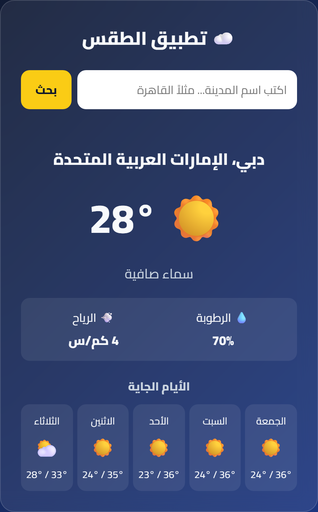

# 01: تطبيق طقس بـ JavaScript

تطبيق بيجيب الطقس دلوقتي لأي مدينة في العالم، وتوقعات الخمس أيام الجاية.
JavaScript بس، من غير أي مكتبات.

📺 **الشرح:** [الفيديو على يوتيوب](https://www.youtube.com/@WatchNdCode)

## اللي هتتعلمه
- `fetch` و `async/await`: إزاي تجيب بيانات من النت.
- إزاي تربط API اتنين ببعض (اسم المدينة ⬅ إحداثيات ⬅ الطقس).
- `try/catch`: إزاي تتعامل مع الأخطاء.
- `localStorage`: تحفظ آخر مدينة اتبحث عنها.

## الـ API
[Open-Meteo](https://open-meteo.com/): مجاني ومش محتاج تسجيل ولا API Key.

## 💪 التحدي
ضيف زرار يجيب طقس مكانك الحالي باستخدام `navigator.geolocation`.
حط الحل بتاعك في كومنتات الفيديو.
