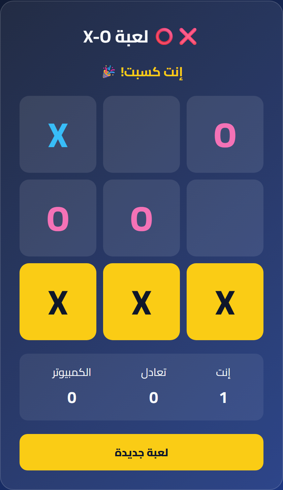

# 02: لعبة X-O ضد الكمبيوتر

لعبة X-O كاملة ضد الكمبيوتر، والسكور بيفضل محفوظ حتى لو قفلت الصفحة.
JavaScript بس، من غير أي مكتبات.

📺 **الشرح:** [الفيديو على يوتيوب](https://www.youtube.com/@WatchNdCode)

## اللي هتتعلمه
- إزاي تمثّل اللوحة بـ array فيه 9 خانات.
- إزاي الكود يعرف مين كسب (8 طرق للفوز).
- مخ للكمبيوتر بـ 5 قواعد: يكسب، يقفل عليك، ياخد النص، ياخد ركن، أي خانة.
- `JSON.stringify` و `JSON.parse`: إزاي تحفظ أوبجكت في `localStorage`.
- `setTimeout`: الكمبيوتر "بيفكر" قبل ما يلعب.

## 🔓 إزاي تكسبه
ابدأ في ركن، وبعدين العب في الركن اللي قصاده.

## 💪 التحدي
صلّح مخ الكمبيوتر علشان مايقعش في الحركتين دول:
لو اللاعب خد ركنين قصاد بعض، الكمبيوتر ياخد خانة على الجنب مش ركن.
حط الحل بتاعك في كومنتات الفيديو.
